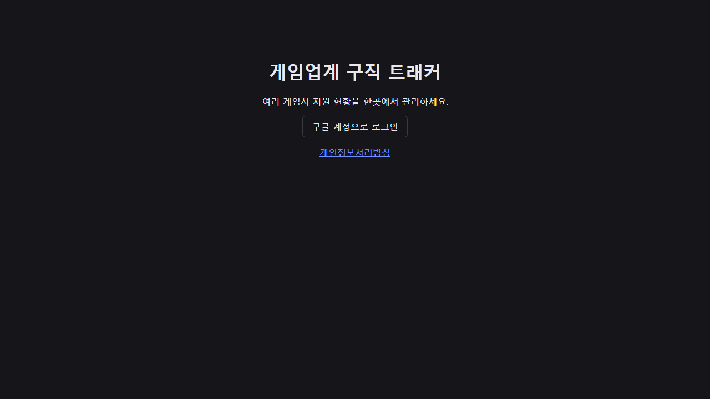
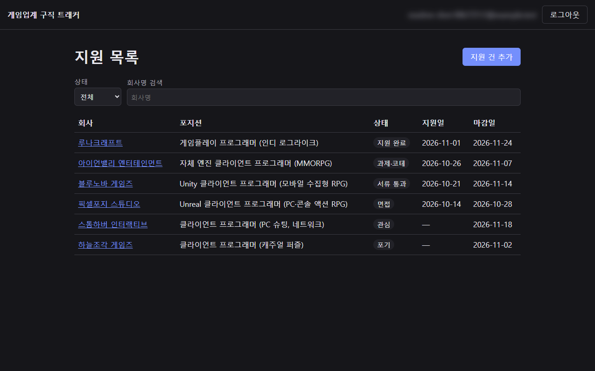
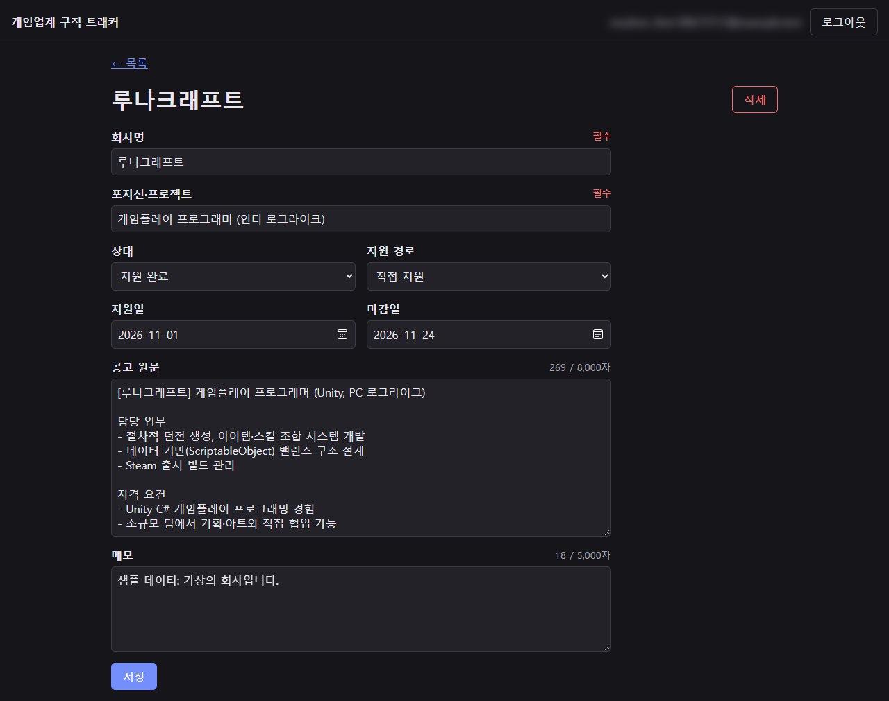
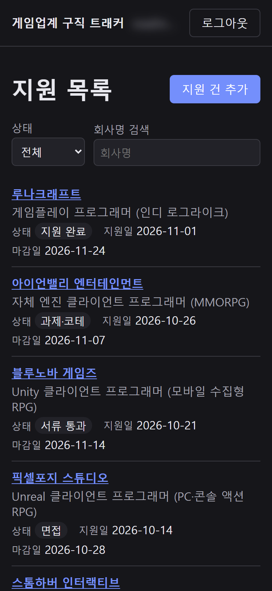
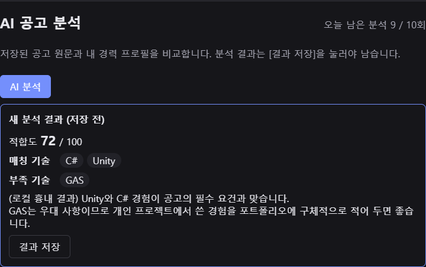
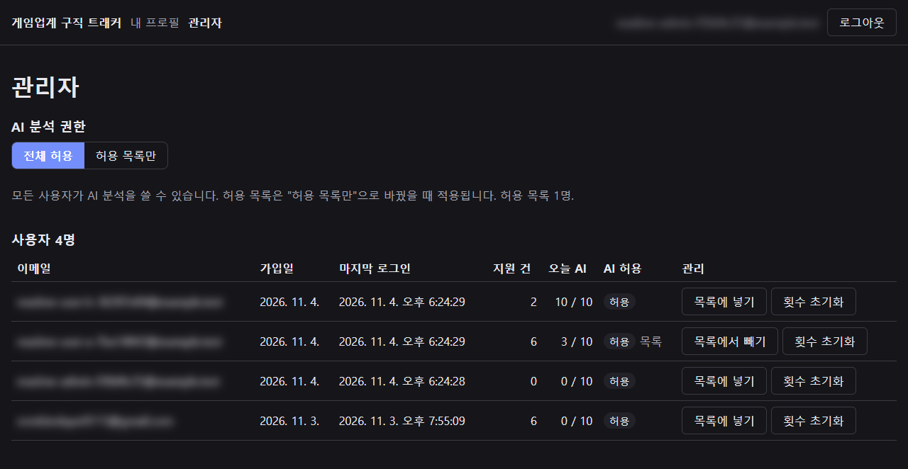

# 게임업계 구직 트래커

여러 게임사에 동시에 지원하는 프로그래머가 회사마다 다른 전형 단계와 지원 이력을 한곳에서 추적하는 웹 서비스입니다.

- **배포 주소: https://game-job-tracker.vercel.app**
- **시연 영상: https://youtu.be/DsNbyke9kxs** (1분 58초)
- **구글 계정으로 로그인해야 사용할 수 있습니다.** 공유 데모 계정은 없습니다. 처음 로그인하면 빈 화면에서 [샘플 데이터 채우기]로 가상 회사 지원 건 6개를 바로 넣어 볼 수 있습니다.
- 개인정보처리방침: https://game-job-tracker.vercel.app/privacy.html

## 핵심 기능 (Must)

| 기능 | 설명 |
|---|---|
| 구글 로그인·로그아웃 | 본인 데이터만 보입니다. 화면에서 숨기는 게 아니라 DB가 다른 사람의 요청을 거부합니다 |
| 지원 건 관리 | 회사, 포지션, 지원 경로, 상태(관심 → 지원 완료 → 서류 통과 → 과제·코테 → 면접 → 최종 합격 / 불합격·포기), 지원일, 마감일, 공고 원문, 메모를 추가·수정·삭제. 상태는 순서와 무관하게 바꿀 수 있습니다 |
| 목록 | 상태 필터, 회사명 검색, 지원일 최신순 정렬(지원일 없는 건은 맨 아래). 필터·검색어는 주소에 남아 새로고침·뒤로가기에도 유지 |
| 샘플 데이터 | 지원 건이 하나도 없을 때만 가상 회사 6건을 내 계정에 채웁니다(프로필이 비어 있으면 가상 프로필도). 여러 탭에서 동시에 눌러도 한 세트만 들어갑니다 |

## 추가 기능 (Should) — 구현 완료

| 기능 | 설명 |
|---|---|
| 경력 프로필 | 경력 요약, 주력 엔진, 기술 스택, 강점, 보완점. 엔진·기술은 태그로 추가·삭제. AI 분석의 기준 데이터이며 본인만 볼 수 있습니다 |
| AI 공고 분석 | 지원 건 상세 화면에서 [AI 분석]을 누르면 저장된 공고 원문과 프로필을 비교해 적합도(0~100), 매칭 기술, 부족 기술, 코멘트를 보여 줍니다. [결과 저장]을 눌러야 남고, 저장된 최신 결과는 상세 화면에 항상 보입니다. 공고 원문을 고치고 저장하지 않았으면 분석 버튼이 꺼집니다 |
| 분석 횟수 한도 | 사용자당 하루 10회, 서비스 전체 하루 100회(한국 시간 자정 초기화). 오늘 남은 횟수가 화면에 보이고, 한도를 넘으면 AI를 부르기 전에 서버가 거부합니다. AI 쪽 오류·시간 초과는 횟수를 차감하지 않습니다 |

검증 기록은 [PRD.md](PRD.md) 10장, 단계별 진행은 [docs/plan.md](docs/plan.md)에 있습니다.

### 화면

| 로그인 | 지원 목록 | 지원 건 상세·편집 | 모바일 |
|---|---|---|---|
|  |  |  |  |

**AI 공고 분석** (로컬에서 AI 흉내 모드로 찍은 화면 — 결과 문구는 예시입니다)



## 관리자 기능 (Could)

운영자가 가입자와 AI 사용을 관리하는 `/admin` 화면입니다. 관리자 지정은 화면이 아니라 Supabase SQL Editor에서만 합니다(`insert into public.admins (user_id) values ('<사용자 ID>');`).

| 기능 | 설명 |
|---|---|
| 유저 목록 | 이메일, 가입일, 마지막 로그인, 지원 건 **개수**, 오늘 AI 사용/한도, AI 허용 여부. 지원 건 내용·메모·프로필·분석 결과는 관리자도 볼 수 없습니다 |
| AI 권한 | 모드 스위치("전체 허용" 기본 / "허용 목록만")와 사용자별 허용 목록 넣기·빼기. 허용 목록이 비었을 때 "허용 목록만"으로 바꾸려 하면 경고합니다. 관리자도 자동으로 허용되지 않습니다 |
| 횟수 초기화 | 사용자의 오늘 AI 사용 횟수를 초기화합니다. 호출 기록은 지우지 않고, 서비스 전체 하루 100회 상한은 그대로 셉니다 |
| 동작 기록 | 허용·해제, 초기화, 모드 변경을 누가 언제 했는지 남깁니다(이메일 없이 사용자 ID만). 기록은 화면·API로 읽거나 고칠 수 없습니다 |

- **화면에서 숨기는 것은 보안이 아닙니다.** 일반 사용자에게는 메뉴가 보이지 않지만, 주소로 들어오거나 API를 직접 불러도 DB 함수가 첫 문장에서 관리자인지 확인해 거부합니다.
- 개인정보처리방침에 "관리자는 운영을 위해 가입자의 이메일 목록과 사용량을 볼 수 있다"를 적었습니다.

**관리자 화면** (로컬 테스트 계정, 이메일은 가림)



## 기술 스택

| 구성 | 선택 | 이유 |
|---|---|---|
| DB·인증·서버 함수 | **Supabase** (Postgres, Auth, Edge Functions) | Postgres RLS가 로그인 토큰과 바로 연결되어 "본인 데이터만"을 DB에서 강제하고, 원자적 처리를 DB 함수 하나로 묶을 수 있음. 카드 없이 무료로 시작 |
| 프런트엔드 | **React + Vite + TypeScript** | 정적 SPA로 충분하고 빌드·배포가 단순함 |
| 배포 | **Vercel** | Git 푸시로 자동 배포, 보안 헤더를 `vercel.json`으로 설정 |
| AI 분석 | **Claude API** (`claude-haiku-5-5`, 구조화 출력) + Supabase Edge Function | 짧은 공고·프로필 비교라 저렴한 Haiku로 충분. 비밀 키는 Edge Function secrets에만 두고 브라우저에는 가지 않음 |

검토하고 버린 후보(Firebase, Next.js + Neon)와 이유는 [docs/design.md](docs/design.md) 1장에 있습니다.

## 보안·권한 설계 요약

- **본인 데이터만 (RLS)**: 모든 표에 RLS를 켜고 `user_id = auth.uid()`인 행만 조회·추가·수정·삭제할 수 있습니다. 다른 계정의 ID로 요청해도 0건이 되고, 소유자를 남으로 바꾸는 수정도 거부됩니다.
- **권한 명시**: 로그아웃 상태(`anon`)에는 표 권한 자체가 없어 요청이 권한 오류로 거부됩니다. 로그인 사용자(`authenticated`)에게는 필요한 권한만 마이그레이션에서 명시적으로 줍니다(운영 프로젝트는 새 표 자동 노출을 꺼 둠).
- **DB 함수 규칙**: 모든 함수에 `search_path = ''`와 스키마 명시, 실행 권한은 필요한 역할에만.
- **동시성**: "확인 후 기록"을 한 트랜잭션 안에서 사용자별 advisory lock을 잡은 뒤 처리합니다.
  - 샘플 채우기: 동시 10건 요청 → 1건만 성공, 나머지는 거부, 정확히 6건.
  - 지원 건 500건 상한: 499건에서 동시에 2건 추가 → 1건만 통과.
- **AI 한도도 원자적으로**: 사용자 한도·전체 한도 확인과 "진행 중" 기록을 전역 잠금 하나로 묶은 DB 함수(`begin_ai_call`, Edge Function만 호출 가능)가 처리합니다. 남은 1회에서 동시 요청이 와도 1건만 통과합니다.
- **AI 분석 서버 함수**: 사용자는 검증된 로그인 토큰에서만 식별하고(요청 본문의 user_id는 무시), 허용된 출처(배포 주소)에서 온 브라우저 요청만 받습니다. 공고 원문은 프롬프트에서 데이터로 구분해 넣고, 결과는 형식 검증을 통과해야 보여 줍니다.
- **상한(화면 + DB 제약)**: 공고 원문 8,000자, 메모 5,000자, 사용자당 지원 건 500건, 프로필 텍스트 각 2,000자·엔진/기술 각 30개, 분석 코멘트 2,000자·기술 목록 각 30개.
- **화면**: 사용자 입력은 텍스트로만 렌더링(HTML 주입 없음). 오류는 정해진 코드·문구로만 보여 주고 DB 원본 오류는 노출하지 않습니다. 로그인 토큰이 만료되면 로그인 화면으로 안내합니다.
- **관리자 기능**: `admins` 표는 사용자가 자기 행 조회만 할 수 있어 스스로 관리자가 될 수 없습니다. 관리자 함수 4개만 SECURITY DEFINER이고(가입자 목록은 `auth.users`를 읽어야 함), 모두 본문 첫 문장에서 관리자를 확인합니다. 이 4개 외에 로그인 사용자가 실행하는 DEFINER 함수는 없다는 것을 테스트로 고정했습니다(Security Advisor 예외는 PRD #20).
- **배포 설정**: CSP·X-Frame-Options 등 보안 헤더, 로그인 복귀 주소는 와일드카드 없이 정확한 주소만, 비밀 키는 브라우저 코드와 저장소에 두지 않음.

자세한 내용: [docs/design.md](docs/design.md) 2~4장(표·권한·원자적 처리), 7장(보안 규칙).

## 로컬 실행

필요 도구: Node.js 24 이상, Docker Desktop(실행 중). Supabase CLI는 루트 `package.json`에 버전을 고정해 두어 `npx supabase`로 씁니다. 아래 명령은 Windows PowerShell 기준입니다.

```powershell
npm install
npm install --prefix web

npx supabase start                                # 로컬 Postgres·Auth (처음엔 Docker 이미지 다운로드)

Copy-Item web\.env.example web\.env.local          # API_URL·PUBLISHABLE_KEY 값을 채운다
npx supabase status -o env

Copy-Item supabase\.env.example supabase\.env      # 로컬 구글 로그인용 클라이언트 ID·secret
npx supabase stop; npx supabase start             # supabase\.env를 바꾼 뒤 재시작

npm run dev --prefix web                          # http://localhost:5173 (127.0.0.1이 아니라 localhost로 열기)
```

- 마이그레이션은 `supabase/migrations/`에 있고 `npx supabase start` 또는 `npx supabase migration up`으로 로컬에 적용됩니다.
- 로컬 Supabase Studio: http://127.0.0.1:54323

## 테스트

```powershell
npm run test:db                                   # 로컬 스택 전용 DB 테스트
npm run test:e2e                                  # 로컬 화면 E2E (Playwright, Windows 기본 Edge)
npm run build --prefix web; npm run lint --prefix web
npx supabase db advisors --type security          # 로컬 보안 점검
```

`npm run test:db`는 로컬 스택이 아니면 실행을 거부하고, 테스트 사용자를 만들어 쓴 뒤 지웁니다.

| 파일 | 확인하는 것 |
|---|---|
| `tests/m2-applications.test.mjs` | 필수값·선택지·길이 제약, 다른 계정 접근 거부, 로그아웃 거부, 500건 상한·동시 추가, 권한·RLS 설정 |
| `tests/m2-rls-auto-enable.test.mjs` | 운영 자동 RLS 함수의 실행 권한 회수 마이그레이션 |
| `tests/m4-search.test.mjs` | 회사명 검색에서 특수문자(`\ . ^ $ * + ? ( ) [ ] { } \| % _`)·한글·대소문자가 글자 그대로 일치 |
| `tests/m5-seed.test.mjs` | 샘플 동시 요청 시 한 세트만, 다른 계정 격리, 재요청 거부 |
| `tests/s1-profiles.test.mjs` | 프로필 저장·사용자당 1행, 다른 계정 접근 거부, 상한, `is_profile_empty()`가 본인 기준으로만 판정, 샘플 채우기 시 프로필 생성 |
| `tests/s2-ai-quota.test.mjs` | 사용자·전체 한도 동시 요청 1건만 통과, 실패 사유별 집계, 2분 지난 진행 중, KST 자정, 표시와 판정이 같은 값, ai_usage 직접 쓰기 거부, 분석 결과 상한 |
| `tests/s3-analyze-posting.test.mjs` | Edge Function: CORS·JWT 검증, 남의 건 404, AI 호출 전 거부, 한도, 실패 사유별 집계, 본문 user_id 무시, 키·JWT·원문이 응답·로그에 없음 (AI는 흉내 모드) |
| `tests/e2e/cross-check.spec.mjs` | 실제 화면에서 추가·상태 유지, 다른 계정의 상세 주소 "찾을 수 없음", 로그아웃 상태 이동, 샘플 버튼 연타 시 6건만, 프로필 저장·격리 |
| `tests/c1-admin.test.mjs` | 일반 사용자의 관리자 함수 거부·DB 불변, `admins` 자기 행만·자기 추가 불가, 초기화 후 사용자 횟수만 복구·전체 유지, 허용 목록 모드 AI 호출 전 거부, 동작 기록과 수정 불가, DEFINER 노출은 관리자 함수 4개뿐·첫 문장 관리자 확인 |
| `tests/e2e/analysis.spec.mjs` | AI 분석 → 저장 → 새로고침 유지, 원문 수정 시 버튼 비활성, 오류 문구, 연타 1회, 결과를 텍스트로만 렌더링 (AI는 흉내 모드) |
| `tests/e2e/admin.spec.mjs` | 관리자 화면: 일반 사용자 메뉴 없음·`/admin` 거부, 목록, 빈 허용 목록 경고, 허용 목록 모드 전환·차단 표시, 초기화, 기록 |
| `tests/prod/cross-check.mjs` | 운영 DB에서 한 트랜잭션 안에 다른 계정 접근·로그아웃·상한·권한(Should 표·관리자 기능 포함)을 검사하고 ROLLBACK (`npm run test:prod`, 절차는 m7-checklist.md 6장). 운영 실행: 2026-11-04 18개(applications만) → S5 48개 통과. C3에서 관리자 검사(#24, 초기화 #25, 동작 기록 #27)를 더해 로컬 77개(운영은 78개 예상) |

배포 주소에서의 검증 절차는 [docs/m7-checklist.md](docs/m7-checklist.md)(Must), [docs/s5-checklist.md](docs/s5-checklist.md)(Should), [docs/c3-checklist.md](docs/c3-checklist.md)(Could 관리자), 결과는 [PRD.md](PRD.md) 10장에 기록합니다.

## 알려진 제약

- **Supabase 무료 플랜 일시 정지**: 일정 기간(약 1주) 활동이 없으면 프로젝트가 일시 정지됩니다. 접속이 안 되면 대시보드에서 다시 시작해야 하며, 심사 기간에는 미리 접속해 깨워 둡니다.
- **Vercel 미리보기 주소에서는 로그인 불가**: 로그인 복귀 주소(Redirect URLs)를 보안상 와일드카드 없이 배포 주소와 `http://localhost:5173`만 등록했기 때문입니다. 로그인은 배포 주소에서만 됩니다.
- 구글 계정 로그인만 지원합니다(이메일·비밀번호 로그인 없음).

## 문서

| 문서 | 내용 |
|---|---|
| [PRD.md](PRD.md) | 요구사항, 서비스 규칙, 검증 기록(10장) |
| [docs/design.md](docs/design.md) | 기술 결정, 표 구조, 권한, 원자적 처리, 보안 규칙 |
| [docs/plan.md](docs/plan.md) | 단계별 작업 목록과 검증 번호 |
| [docs/m7-checklist.md](docs/m7-checklist.md) | 배포 주소 Must 검증 절차, 운영 DB 롤백 검사 실행 방법 |
| [docs/s5-checklist.md](docs/s5-checklist.md) | Should 검증: 배포 주소 확인 항목과 로컬 테스트로 대신하는 항목 |
| [docs/c3-checklist.md](docs/c3-checklist.md) | Could(관리자) 검증: 배포 주소 확인 항목과 로컬 테스트로 대신하는 항목 |
| [retrospective.md](retrospective.md) | 회고 |
